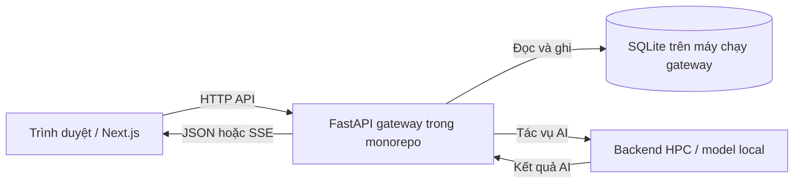

# Backend và database của bản nộp Client

Bản nộp [majormatch-client](https://github.com/MajorMatch-Labs/majormatch-client) là phần `client/` được tách từ [MajorMatch monorepo](https://github.com/MajorMatch-Labs/MajorMatch). Vì vậy không có mã Python hoặc file database trong bản nộp frontend. Đây là ranh giới repository, không phải bằng chứng hệ thống không có database.

Đối chiếu mã nguồn ngày 27/10/2026, baseline monorepo `0154bcf`. Các liên kết dưới đây cố định theo commit để giảng viên kiểm tra được đúng phiên bản; không khẳng định trạng thái triển khai hiện tại trên EC2.

| Thành phần | Bằng chứng trong monorepo | Vai trò |
|---|---|---|
| Cloud gateway | [backend-hpc/cloud_gateway.py](https://github.com/MajorMatch-Labs/MajorMatch/blob/0154bcf/backend-hpc/cloud_gateway.py) | FastAPI, các API tài khoản, hồ sơ, khảo sát, phân tích, lộ trình, chat; đọc/ghi SQLite |
| Database gateway | Cùng file: `DB_PATH`, `get_db`, `init_db` và các câu `CREATE TABLE` | Dùng `MAJORMATCH_DB_PATH`; mặc định `~/data/majormatch.db` theo tài khoản chạy tiến trình |
| Database backend HPC | [backend-hpc/database.py](https://github.com/MajorMatch-Labs/MajorMatch/blob/0154bcf/backend-hpc/database.py) | Lớp SQLite của backend HPC, mặc định cạnh module Python; không đồng nghĩa là cùng file với gateway |
| REST client | [src/services/api.ts](../../src/services/api.ts) | Trình duyệt gọi `/api/v1/...`, không mở kết nối SQL trực tiếp |
| State client | [src/stores/useProfileStore.ts](../../src/stores/useProfileStore.ts) | Zustand và bộ nhớ trình duyệt hỗ trợ giao diện; khác với dữ liệu đã lưu trên server |
| Proxy phát triển | [next.config.mjs](../../next.config.mjs) | Rewrite `/api/:path*` sang backend cấu hình bằng `NEXT_PUBLIC_API_URL`; triển khai có thể dùng Nginx phía trước |

Gateway tạo các bảng `users`, `user_profiles`, `riasec_surveys`, `assessments`, `roadmaps`, `chat_history`, `admin_audit`. Nội dung gồm tài khoản, hồ sơ học tập, câu trả lời RIASEC, kết quả phân tích, lộ trình/tiến độ và lịch sử chat. File `.db` là dữ liệu vận hành và được gitignore; không đưa thông tin thật hoặc bản backup vào bài nộp.

## Case demo kiểm chứng lưu trữ

1. Dùng tài khoản test và dữ liệu tổng hợp, đăng nhập rồi trả lời khảo sát.
2. Trong Network, kiểm tra `POST /api/v1/survey/riasec` thành công; đối chiếu handler trong gateway.
3. Đăng xuất, đăng nhập lại và kiểm tra `GET /api/v1/survey/riasec/{student_id}` trả dữ liệu đã lưu.
4. Khi có quyền server, đối chiếu bản ghi SQLite bằng truy vấn chỉ đọc. Không công khai mã sinh viên, token, nội dung hồ sơ hoặc dump database.
5. Lưu ảnh đã che thông tin và kết quả thật vào báo cáo tuần 8/9. Quy trình này chưa được chạy trong phiên refactor tuần 7.

Chỉ một lần reload trang không đủ chứng minh server đã lưu dữ liệu vì client có thể khôi phục từ localStorage. Kiểm tra API và database mới phân biệt được hai nguồn. Tài liệu này xác nhận mã triển khai; độ bền lưu trữ, phân quyền và backup của môi trường chạy cần kiểm chứng riêng.
