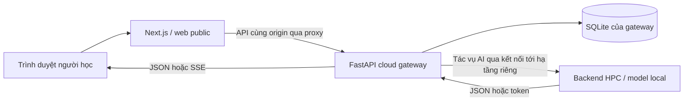

# MajorMatch: từ bằng chứng học tập đến gợi ý chuyên ngành

Học phần: Chuyên đề 4, CS2028. Phạm vi nộp: repo `majormatch-client`, tương ứng `client/` trong monorepo MajorMatch. Ngày tổng hợp: 03/11/2026. Baseline mã nguồn monorepo `108c6ff`, client tree `336b43757266e6963c44d4c21b532c6b89dd560f`.

Phân công chuyên môn: Văn Hoàng — Ingestion, Ánh Vy — Analytics, Long Nhật — Advisor/Core. Codex hỗ trợ soạn bản chương 9 theo yêu cầu của người dùng. Phân công này không xác nhận mọi file do từng người tự viết hoặc owners đã duyệt. Minh chứng actor/commit/review xem [delivery record](chapter-9-delivery.md).

## 1. Bài toán và người dùng

Sinh viên cần đối chiếu môn đã học, kỹ năng và sở thích với một số hướng chuyên ngành, sau đó chọn việc học tiếp theo. MajorMatch cung cấp hồ sơ đầu vào, khảo sát RIASEC, gợi ý ngành, radar/skill gap, lộ trình và cố vấn hội thoại. Mục tiêu là hỗ trợ quyết định; chưa có thử nghiệm người dùng chứng minh hệ thống chọn ngành chính xác hay làm tăng khả năng có việc làm.

Ví dụ xuyên suốt dùng sinh viên tổng hợp `TEST-DEMO-001`: người học có PDF mẫu và muốn so sánh Cloud với Data. Sau khi xem gợi ý, người học chọn một ngành, tạo lộ trình và hỏi trợ lý về môn tiên quyết. Không dùng bảng điểm thật trong ảnh, payload mẫu hay video nộp bài.

## 2. Sản phẩm đã triển khai và phạm vi

| Màn hình | Trách nhiệm | Giới hạn diễn giải |
|---|---|---|
| `/upload` | Upload PDF, câu trả lời RIASEC, lĩnh vực quan tâm | Task AI live cần backend; validation client chưa xác nhận nội dung tài liệu đúng |
| `/result` | So sánh ngành, radar, bảng số liệu, các nhóm kỹ năng | Match/fit là chỉ số theo mô hình/công thức đang dùng, chưa có đánh giá hiệu lực thực tế |
| `/result?demo=1` | Báo cáo mẫu có nhãn minh họa | Không phải kết quả cá nhân hoặc kết nối model thật |
| `/roadmap` | Lộ trình học, môn học, nhiệm vụ và checklist | Tick nhiệm vụ là mô phỏng; store đang có hành vi thay đổi cả dữ liệu phân tích |
| `/chat` | Lịch sử theo phiên và streaming SSE | Có guard ngữ cảnh và Stop; còn fallback định danh/GPA và cần kiểm chứng phân quyền backend |
| `/profile`, `/admin` | Hồ sơ và quản trị | Có mã giao diện/API, không nằm trong bộ E2E live bảo mật của báo cáo này |

Nguồn: `src/app`, `src/components`, `src/services/api.ts`, `src/stores`. README cũ có mô tả auto-fallback và privacy rộng hơn bằng chứng hiện tại; báo cáo này ưu tiên mã và kết quả chạy thực.

## 3. Kiến trúc và database nằm ở đâu

Client sử dụng Next.js 14.2.14, React 18, TypeScript, Tailwind, Zustand, Recharts. Ingestion tiếp nhận dữ liệu; Analytics chuyển đổi và trình bày; Advisor/core điều phối lộ trình, trạng thái và chat. REST mang hồ sơ/kết quả; SSE mang token hội thoại qua HTTP POST.

Sơ đồ biểu diễn vai trò logic; không xác nhận mọi node đang online ngày viết báo cáo. [Gateway ở monorepo](https://github.com/MajorMatch-Labs/MajorMatch/blob/108c6ff/backend-hpc/cloud_gateway.py) đọc SQLite theo `MAJORMATCH_DB_PATH`, mặc định `~/data/majormatch.db` của tài khoản chạy service. Database có users, hồ sơ, khảo sát, assessments, roadmaps, chat history và admin audit. File `.db` được gitignore. [database.py](https://github.com/MajorMatch-Labs/MajorMatch/blob/108c6ff/backend-hpc/database.py) của HPC có đường dẫn riêng; không tự coi đó là cùng DB với gateway.

Zustand persist ở browser là trạng thái/cached data phục vụ UI. Reload phục hồi thành công không chứng minh SQLite đã ghi. Chứng minh persistence cần response API, mở phiên lại và đối chiếu server. Xem [backend evidence](../02-architecture/MONOREPO_BACKEND_EVIDENCE.md).

Trong case Hybrid Cloud liên quan môn điện toán đám mây, web/gateway là phần public cloud và HPC là hạ tầng cục bộ. Script Joy3 ở monorepo khai báo reverse SSH để EC2 gọi vào edge, rồi edge chuyển tới HPC. Repo cũng có template Cloudflare Tunnel, nhưng có template không chứng minh nó đang chạy. Tự mở rộng EC2 theo tải và bảo đảm tính sẵn sàng chưa được xác minh trong chương 9. Không gọi một kết nối cloud-local đơn thuần là autoscaling hoàn chỉnh.

## 4. Hợp đồng dữ liệu và các phép tính

Upload dùng FormData và DTO `TranscriptParsingResponse`; API adapter chấp nhận `profile_data`/alias `profile`. Khảo sát giữ 10 câu riêng. Điểm RIASEC là trung bình có trọng số theo dataset, không phải LLM đo tâm lý. Mã Holland lấy hai nhóm cao nhất. [Ingestion specification](../ingestion/specification.md) ghi cả fallback 3.0 ở utility và guard đủ câu ở UI.

Analytics lọc score không finite, làm tròn 1 chữ số và giữ zero thật. Radar có bảng thay thế, trạng thái partial và reduced motion. Ngưỡng delta ±0.5 của chart khác ngưỡng gap >1.0 trong summary; cần thống nhất trước khi sử dụng cho kết luận định lượng. Catalogue mô tả rõ [công thức và giới hạn](../analytics/design-system-catalogue.md).

Advisor ràng buộc callbacks theo learner/session/major/profile/answers/tags, vô hiệu hóa request cũ khi Stop, và bỏ response history muộn. SSE chỉ completed khi có done; EOF trước done là interrupted. Các guard này không thay kiểm tra quyền sở hữu dữ liệu trên server.

## 5. Quy trình AI hỗ trợ phát triển

Nhóm lưu PRD/user stories, prototype, mã, unit/component/E2E tests và nhật ký AI theo module. Chương 7 bổ sung refactor có kiểm chứng: tách upload, kiểm tra evidence radar và session SSE. Chương 8 bổ sung test component và browser; các PR [client #22](https://github.com/MajorMatch-Labs/majormatch-client/pull/22), [#23](https://github.com/MajorMatch-Labs/majormatch-client/pull/23) và monorepo tương ứng ghi diff/review thật.

Trong chương 9, Codex đọc source thay vì chỉ dựa vào README; phát hiện false return của save, scoring fallback và mô phỏng mutate baseline; đưa các giới hạn vào specification/báo cáo. Phần prompt evolution phân biệt nhật ký lịch sử với prompt đề xuất chưa chạy. Không tạo review dưới tên thành viên khác hoặc tự chấm điểm Rubric.

## 6. Kiểm chứng và số đo

Kết quả mới nhất của phiên này được ghi trong [delivery record](chapter-9-delivery.md), gồm lệnh, exit code và trạng thái môi trường. Bộ kiểm tra mã có 77 ca ở 14 files; Playwright có 8 lần chạy cho hai viewport Chromium. Khi browser executable chưa có trên máy, E2E dừng ở môi trường; phải cài đúng browser rồi mới ghi pass.

Các ca chat E2E intercept API và dùng dữ liệu tổng hợp; component tests mock renderer/controller. Chúng chứng minh hành vi UI/guard, không phải chất lượng model, lưu trữ SQLite hay độ an toàn của hạ tầng live. Test pass không phải coverage 100% và không tự chứng nhận accessibility.

[Báo cáo Lighthouse](../analytics/lighthouse-report.md) lưu số đo local production, version công cụ, viewport/throttling và cảnh báo. Một lần đo mỗi cấu hình chỉ là quan sát lab, chưa đại diện EC2, thiết bị sinh viên hoặc lợi ích UX thực tế. Số đo không được điền bằng mục tiêu mong muốn.

## 7. Triển khai và chuyển giao

Repo client clone độc lập giữ code/tests/docs; phần backend được liên kết bằng commit cố định trong monorepo. Để chạy UI: dùng Node tương thích, `npm ci`, cấu hình backend test khi cần live, `npm run dev`. Demo tường minh không yêu cầu người trình bày nhận dữ liệu mẫu thành dữ liệu thật. Production dùng `npm run build` rồi `npm start` hoặc standalone/Docker theo cấu hình repo. Cách chạy và diễn tập nằm trong [demo and defense](demo-and-defense.md).

Phát hành client subtree trước rồi cùng nhánh sang monorepo, mở PR và đối chiếu tree. Merge chỉ sau kiểm tra và khi người dùng cho phép. Chương 9 được người dùng cho phép merge; trạng thái remote phải được kiểm tra bằng GitHub, không suy ra từ commit local.

## 8. Rủi ro và công việc tiếp theo

Ưu tiên một: sửa các caller chưa kiểm tra false của API lưu; kiểm chứng phân quyền và loại fallback định danh/GPA khỏi phiên live. Tiếp theo: tách simulation khỏi baseline match/radar, giữ zero bằng nullish handling thay `||`, duyệt ý nghĩa readiness. Rà advisory và nâng dependency Next/Recharts có regression suite riêng. Bổ sung E2E backend thật, backup/restore SQLite, model offline/queue/retry và đo nhiều lượt trên môi trường cố định.

Không khẳng định upload khử PII 100%, model hoàn toàn chính xác, browser cache tương đương cloud DB, hoặc hệ thống đã autoscale AWS khi chưa có bằng chứng. Những giới hạn này là phần cần giải thích khi bảo vệ, không phải lỗi tài liệu cần che đi.

## 9. Ánh xạ chuẩn đầu ra

CLO2: prompt và công cụ AI hỗ trợ tạo tài liệu/test. CLO3: đối chiếu source, phát hiện mâu thuẫn và ghi quyết định sửa/giới hạn. CLO4: bộ tài liệu bàn giao, demo, slide và trách nhiệm nhóm. [Ma trận minh chứng](rubric-evidence.md) đưa link cụ thể; điểm số là quyền đánh giá của giảng viên.
