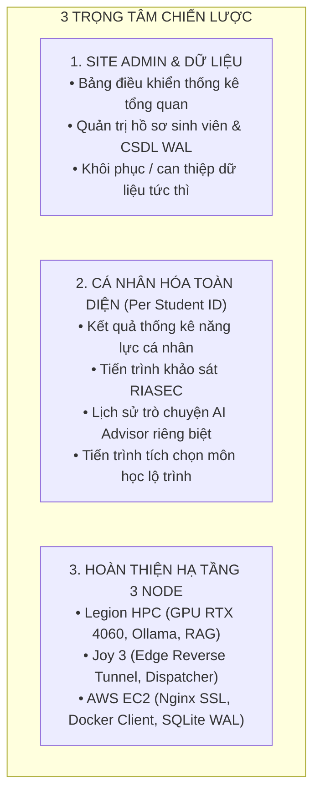
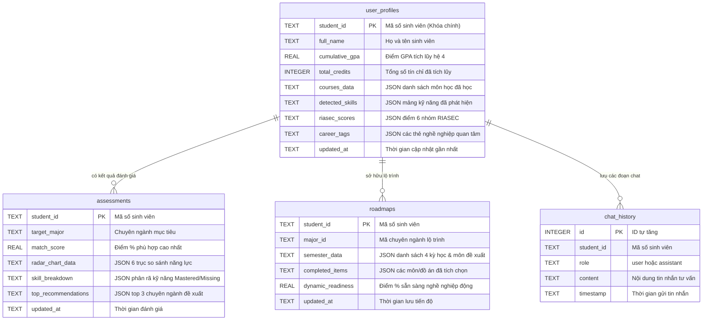

# KẾ HOẠCH TRIỂN KHAI VÀ PHÂN CÔNG NHIỆM VỤ
## CHUYÊN ĐỀ 4: AI PRODUCT DEVELOPMENT (CS2028)
### GIAI ĐOẠN: SITE ADMIN QUẢN TRỊ DỮ LIỆU - CÁ NHÂN HÓA HỆ THỐNG - HOÀN THIỆN HẠ TẦNG 3 NODE
> **Dự án**: MajorMatch - Hệ sinh thái Cố vấn Học tập & Định hướng Chuyên ngành Đa tầng  
> **Cập nhật ngày**: 18/10/2026  
> **Repository chính**: [MajorMatch-Labs/MajorMatch](https://github.com/MajorMatch-Labs/MajorMatch.git) | [NhatPrv/MajorMatch](https://github.com/NhatPrv/MajorMatch.git)

---

## 1. MỤC TIÊU CỐT LÕI CỦA BUỔI LÀM VIỆC

1. **Site Admin Quản lý & Xử lý Dữ liệu Ứng dụng**:
   - Hoàn thiện bảng điều khiển Admin (`/admin`): Giám sát dung lượng CSDL SQLite WAL, tổng số bản ghi thời gian thực.
   - Quản trị danh sách người dùng (`user_profiles`), kết quả đánh giá (`assessments`), lộ trình học tập (`roadmaps`), và hội thoại tư vấn (`chat_history`).
   - Cung cấp các công cụ xử lý: Tìm kiếm theo mã sinh viên, phân trang, kiểm tra Pretty JSON và xoá bản ghi an toàn.
2. **Cá nhân hóa Trải nghiệm Người dùng (Student-Centric Personalization)**:
   - Tất cả dữ liệu nghiệp vụ phải được ràng buộc chặt chẽ với ít nhất một định danh duy nhất (`student_id`).
   - Tự động nạp lại trạng thái cá nhân khi sinh viên quay lại hệ thống:
     * **Kết quả thống kê**: GPA, số tín chỉ, danh mục kỹ năng đã phát hiện, độ lệch năng lực so với chuẩn chuyên ngành.
     * **Tiến trình khảo sát**: Điểm 6 nhóm Holland RIASEC (R-I-A-S-E-C) và các thẻ nghề nghiệp quan tâm.
     * **Lịch sử hội thoại AI**: Khôi phục đầy đủ ngữ cảnh tin nhắn của sinh viên với Trợ lý AI Qwen 2.5.
     * **Tiến trình lộ trình**: Ghi nhớ trạng thái hoàn thành từng môn học/đồ án, tự động tính toán lại tỷ lệ sẵn sàng việc làm (Dynamic Readiness Score) theo thời gian thực.
3. **Hoàn thiện Cấu trúc Hạ tầng Phân tán 3 Node**:
   - Duy trì ổn định đường hầm Reverse Tunnel từ Legion HPC $\leftrightarrow$ Joy 3 $\leftrightarrow$ AWS EC2.
   - Đảm bảo cơ chế tự động phục hồi kết nối, ghi log chi tiết từng request và cô lập tài nguyên an toàn.

---

## 2. MA TRẬN PHÂN CÔNG NHIỆM VỤ CHI TIẾT (3 THÀNH VIÊN)

### 👤 THÀNH VIÊN 1: BẠN / LONG NHẬT (TECH LEAD - PHỤ TRÁCH NODE HPC & BACKEND CORE)
> **Phạm vi**: Legion HPC Node (GPU RTX 4060), FastAPI Backend (`backend-hpc`), Hạ tầng kết nối 3 Node, API Cá nhân hóa & Admin.  
> **Git Branch**: `feat/longnhat-hpc-personalization-and-admin-api`  
> **Git Author**: `Đặng Long Nhật <torikun2005@gmail.com>`

* **Mục tiêu chính**:
  1. **Duy trì & Tối ưu hóa Node HPC GPU**:
     - Vận hành dịch vụ Ollama cục bộ (`ollama serve`) với mô hình `qwen2.5:7b-instruct-q4_K_M` trên GPU RTX 4060 Laptop (8GB VRAM).
     - Đảm bảo cơ chế Semaphore tuần tự (Queue = 1) để tránh tràn VRAM khi có nhiều truy vấn đồng thời.
  2. **Xây dựng & Hoàn thiện API Cá nhân hóa Dữ liệu**:
     - `GET /api/v1/user/{student_id}/full-state`: Lấy trọn vẹn trạng thái cá nhân hóa (hồ sơ, điểm RIASEC, kết quả match gần nhất, tiến trình lộ trình và lịch sử chat).
     - `POST /api/v1/chat/history`: Lưu trữ hội thoại thời gian thực gắn với `student_id`.
     - `GET /api/v1/chat/history/{student_id}`: Trích xuất lịch sử chat của sinh viên với phân trang.
     - `POST /api/v1/roadmap/progress`: Cập nhật trạng thái tích chọn môn học và tính toán lại điểm Job Readiness.
  3. **Hoàn thiện API Quản trị Admin trên Cloud Gateway**:
     - Đảm bảo các endpoint `/api/v1/admin/stats`, `/api/v1/admin/table/{table_name}`, `/api/v1/admin/backup` chạy mượt mà trên EC2 qua HTTPS.
  4. **Kiểm soát Hạ tầng & Độ ổn định**:
     - Viết script giám sát liveness giữa Joy 3 và Legion HPC.
     - Đóng gói tài liệu vận hành và minh chứng AI `client/docs/ai-evidence/advisor/w8-hpc-prompt-log.md`.

---

### 👤 THÀNH VIÊN 2: NGUYỄN VĂN HOÀNG (MODULE INGESTION & DATA MANAGEMENT)
> **Phạm vi**: Xử lý dữ liệu đầu vào, Quản trị CSDL Người dùng, Cá nhân hóa Khảo sát RIASEC.  
> **Git Branch**: `feat/vanhoang-ingestion-personalization-admin`  
> **Git Author**: `Nguyễn Văn Hoàng <hoangtungmy123@gmail.com>`

* **Mục tiêu chính**:
  1. **Quản trị Dữ liệu Sinh viên trên Site Admin**:
     - Xây dựng bộ lọc, tìm kiếm sinh viên theo MSSV (`student_id`), GPA và chuyên ngành trên bảng `user_profiles`.
     - Xây dựng tính năng xuất dữ liệu (Export JSON / CSV) danh sách sinh viên phục vụ công tác thống kê đào tạo.
  2. **Cá nhân hóa Tiến trình Khảo sát RIASEC**:
     - Lưu trữ tự động từng câu trả lời trắc nghiệm của sinh viên vào `localStorage` và đồng bộ vĩnh viễn về CSDL Cloud qua API.
     - Tự động nạp lại kết quả trắc nghiệm RIASEC cũ nếu sinh viên đã từng thực hiện trước đó (không bắt làm lại từ đầu nếu không muốn).
     - Hỗ trợ tính năng "Làm lại khảo sát" để cập nhật định hướng mới.
  3. **Chuẩn hóa Dữ liệu Học bạ theo `student_id`**:
     - Bắt buộc kiểm tra và tự động điền MSSV khi trích xuất bảng điểm PDF.
     - Tích hợp kiểm tra ràng buộc khóa ngoại (Foreign Key) đảm bảo dữ liệu luôn toàn vẹn.
  4. **Tài liệu & Minh chứng**:
     - Viết tài liệu đặc tả cấu trúc bảng dữ liệu `docs/03-specifications/database-schema-spec.md`.
     - Viết nhật ký minh chứng AI `client/docs/ai-evidence/ingestion/w8-admin-prompt-log.md`.

---

### 👤 THÀNH VIÊN 3: THANH PHONG (MODULE ANALYTICS, CHAT UI & ADMIN DASHBOARD)
> **Phạm vi**: Trực quan hóa Cá nhân hóa (Analytics Radar, Chat History Drawer, Roadmap Progress, Admin UI).  
> **Git Branch**: `feat/thanhphong-analytics-personalization-ui`  
> **Git Author**: `Thanh Phong <thanhphong.vku@gmail.com>`

* **Mục tiêu chính**:
  1. **Cá nhân hóa Trực quan Năng lực Sinh viên (Analytics Radar)**:
     - Hiển thị biểu đồ so sánh đa tầng: Năng lực hiện tại của riêng sinh viên (`user_score`) vs Chuẩn mực ngành mục tiêu (`benchmark_score`).
     - Tự động làm nổi bật các trục năng lực còn thiếu (Skill Gap) dựa trên tiến trình môn học đã tích chọn.
  2. **Giao diện Khôi phục & Quản lý Lịch sử Chat AI**:
     - Thiết kế ngăn kéo (Drawer/Sidebar) hiển thị danh sách các phiên trò chuyện trước đây của sinh viên.
     - Nút "Tải lại lịch sử hội thoại" khôi phục toàn bộ tin nhắn tư vấn cũ của sinh viên với AI Advisor.
  3. **Đồng bộ Tiến trình Lộ trình (Roadmap Dynamic Checkbox)**:
     - Nâng cấp giao diện cây lộ trình: hiển thị huy hiệu `% Hoàn thành học kỳ`, tự động cập nhật thanh tiến độ tổng thể khi sinh viên tích chọn môn học.
     - Đồng bộ tức thì chỉ số `% Sẵn sàng Nghề nghiệp` (Dynamic Job Readiness) trên Header và Dashboard.
  4. **Hoàn thiện Giao diện Site Admin (`/admin`)**:
     - Thiết kế các biểu đồ phân tích thống kê (Distribution Charts): Phân bố sinh viên theo chuyên ngành, phân bố điểm RIASEC trung bình của toàn khóa.
     - Tinh chỉnh giao diện Pretty JSON Modal và thông báo tương tác (Toast Notifications) khi thực hiện các tác vụ quản trị.
  5. **Tài liệu & Minh chứng**:
     - Viết tài liệu hướng dẫn sử dụng giao diện Admin `docs/04-operations/ADMIN_USER_GUIDE.md`.
     - Viết nhật ký minh chứng AI `client/docs/ai-evidence/analytics/w8-admin-prompt-log.md`.

---

## 3. THIẾT KẾ DỮ LIỆU CÁ NHÂN HÓA (DATABASE SCHEMA PER STUDENT)

Mọi dữ liệu trên máy chủ SQLite WAL (`/home/ubuntu/data/majormatch.db`) tuân thủ cấu trúc liên kết:

---

## 4. QUY TRÌNH PHỐI HỢP VÀ GIAO TIẾP GIT

1. **Khởi tạo nhánh làm việc độc lập**:
   * Long Nhật: `git checkout -b feat/longnhat-hpc-personalization-and-admin-api`
   * Văn Hoàng: `git checkout -b feat/vanhoang-ingestion-personalization-admin`
   * Thanh Phong: `git checkout -b feat/thanhphong-analytics-personalization-ui`
2. **Quy tắc Commit Message**:
   * Phải viết $100\%$ bằng tiếng Anh theo chuẩn Conventional Commits: `<type>(<scope>): <description>`.
   * Gán đúng danh tính tác giả (`user.name` và `user.email`).
3. **Tiêu chuẩn nghiệm thu (Acceptance Criteria)**:
   * [ ] Mở trình duyệt tại `https://majormatch.vanhoang.online/admin`: Xem được danh sách sinh viên, thống kê phân bố và thao tác quản trị không bị lỗi.
   * [ ] Đăng nhập hoặc nhập `student_id`: Toàn bộ khảo sát RIASEC, biểu đồ Radar, lịch sử chat và tiến trình lộ trình của riêng sinh viên đó được khôi phục chính xác $100\%$.
   * [ ] Node HPC hoạt động ổn định trên GPU RTX 4060, kết nối thông suốt từ Cloud EC2 $\rightarrow$ Joy 3 $\rightarrow$ Legion HPC.
   * [ ] Tất cả bài kiểm thử tự động `npm run test` đạt $100\%$ PASSED.
   * [ ] Biên dịch `npm run build` không có lỗi.
