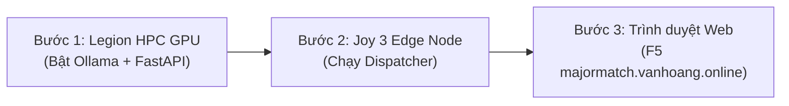

# HƯỚNG DẪN KẾT NỐI, KHỞI CHẠY VÀ THEO DÕI LOG HỆ THỐNG MAJORMATCH
====================================================================
> **Dự án**: MajorMatch - Hệ thống Cố vấn Học tập & Định hướng Chuyên ngành dựa trên AI Đa tầng  
> **Cập nhật gần nhất**: 15/10/2026  
> **Tài liệu áp dụng cho**: Máy trạm Windows (Legion HPC), Joy 3 (Edge Node), AWS EC2 (Cloud Node)

---

## 1. BẢNG TỔNG HỢP THÔNG SỐ VẬN HÀNH

| Mắt xích | Vai trò chính | Địa chỉ IP / Tên miền | Cổng dịch vụ | Thông tin xác thực SSH |
| :--- | :--- | :--- | :--- | :--- |
| **AWS EC2 Cloud** | Reverse Proxy, SQLite DB, Docker Client, API Gateway | `13.250.26.54`<br>`https://majormatch.vanhoang.online` | `80` (HTTP)<br>`443` (HTTPS SSL)<br>`8001` (Gateway API)<br>`3000` (Next.js)<br>`8000` (Ingress Tunnel) | **User**: `ubuntu`<br>**Key**: `C:\Users\Lenovo\.ssh\aws\device-control-key.pem`<br>**Port SSH**: `22` |
| **Joy 3 Edge Node** | Cổng biên điều phối, in log thời gian thực, mở đường hầm Reverse Tunnel | `100.71.182.24` (Tailscale)<br>`192.168.100.127` (Wi-Fi) | `8022` (SSH Termux)<br>`18080` (Ingress Dispatcher)<br>`8080` (Nginx Edge) | **User**: `root`<br>**Password**: `123456`<br>**Port SSH**: `8022` |
| **Legion HPC GPU** | Tính toán suy luận AI (Qwen 2.5 7B Q4_K_M, Cosine Matrix) | `100.123.107.114` (Tailscale)<br>`192.168.100.155` (Wi-Fi) | `8000` (FastAPI Engine)<br>`11434` (Ollama LLM) | Chạy cục bộ trên máy tính cá nhân (NVIDIA RTX 4060 8GB VRAM) |

---

## 2. QUY TRÌNH 3 BƯỚC KHỞI CHẠY HỆ THỐNG HOÀN CHỈNH

Để hệ thống sáng **đèn xanh `HPC Node Ready`** và hiển thị **`Qwen 2.5 Local LLM`**, hãy thực hiện theo đúng thứ tự 3 bước sau:



---

### BƯỚC 1: KHỞI CHẠY TRÊN MÁY TÍNH CÁ NHÂN (LEGION HPC GPU)

Mở 2 cửa sổ PowerShell riêng biệt trên máy tính Legion:

#### 1. Cửa sổ 1: Bật dịch vụ Ollama (GPU RTX 4060)
```powershell
ollama serve
```
*(Đảm bảo hiển thị dòng: `inference compute id=0 ... NVIDIA GeForce RTX 4060 Laptop GPU` và `Listening on 127.0.0.1:11434`)*.

#### 2. Cửa sổ 2: Khởi động FastAPI Backend (Cổng 8000)
```powershell
cd c:\mydata\selfproject\AIO_project\backend-hpc
.\.venv\Scripts\activate
uvicorn main:app --host 0.0.0.0 --port 8000 --reload
```

#### 3. Kiểm tra nhanh tại chỗ:
```powershell
curl.exe -s http://localhost:8000/api/v1/health
```
*(Nếu trả về JSON có `"gpu_status": "NVIDIA CUDA GPU"` là Bước 1 thành công)*.

---

### BƯỚC 2: KHỞI CHẠY TRÊN JOY 3 (EDGE NODE DISPATCHER)

Mở màn hình Joy 3 (Termux / Ubuntu) hoặc SSH từ máy tính cá nhân sang Joy 3:

#### 1. Lệnh SSH từ máy tính vào Joy 3 (Nếu không gõ trực tiếp trên máy Joy 3):
```powershell
ssh -p 8022 root@100.71.182.24
# Nhập mật khẩu: 123456
```

#### 2. Đăng nhập vào môi trường Ubuntu (Nếu vừa mở Termux):
```bash
proot-distro login ubuntu
```

#### 3. Chạy script điều phối & xem log thời gian thực:
```bash
python3 /root/joy3_edge_dispatcher.py
```

Khi màn hình Joy 3 hiện:
```text
[+] Mở SSH Reverse Tunnel về EC2 (Port 8000 -> 18080)...
[✓] SSH Tunnel sẵn sàng: Ingress AWS Port 8000 ➔ Joy 3 ➔ Legion HPC
[✓] Joy 3 Edge Node đang lắng nghe trên port 18080...
```
👉 **Giữ nguyên cửa sổ này để xem log từng request từ Client đổ về!**

---

### BƯỚC 3: MỞ TRÌNH DUYỆT VÀ KIỂM TRA

1. Truy cập: **`https://majormatch.vanhoang.online/chat`**
2. Nhấn **F5** (hoặc `Ctrl + Shift + R`).
3. Thanh Header sẽ hiển thị **đèn xanh `HPC Node Ready`** và badge **`Qwen 2.5 Local LLM`**.
4. Mọi câu hỏi bạn gửi đi sẽ xuất hiện ngay lập tức trên terminal Joy 3 với định dạng:
   ```text
   📱 [JOY 3 EDGE NODE - 16:55:40]
      ▶ Yêu cầu từ Client   : POST /api/v1/chat/stream
      ▶ Chuyển tiếp tới HPC : http://100.123.107.114:8000/api/v1/chat/stream
      ▶ [STREAMING TOKENS]  : Đang truyền token từ Qwen 2.5...
      ▶ Hoàn tất            : HTTP 200 (8700 ms)
   ```

---

## 3. CÁC LỆNH POWERSHELL TIỆN ÍCH TRÊN MÁY TÍNH (CHƯA CẦN SSH)

Các lệnh sau chạy trực tiếp trên PowerShell Windows của bạn để kiểm tra hạ tầng AWS từ xa:

### 1. Kiểm tra trạng thái hệ thống tổng thể (Health Check)
```powershell
curl.exe -s https://majormatch.vanhoang.online/api/v1/health | ConvertFrom-Json | ConvertTo-Json -Depth 5
```

### 2. Kiểm tra độ mở cổng mạng (Port 443, 80, 22)
```powershell
# Kiểm tra HTTPS Tên miền
Test-NetConnection -ComputerName majormatch.vanhoang.online -Port 443

# Kiểm tra SSH IP Public AWS EC2
Test-NetConnection -ComputerName 13.250.26.54 -Port 22
```

### 3. Thử nghiệm suy luận AI Streaming trực tiếp từ PowerShell
```powershell
curl.exe -N -X POST "https://majormatch.vanhoang.online/api/v1/chat/stream" `
  -H "Content-Type: application/json" `
  -d '{"message":"Xin chào","target_major":"AI"}'
```

---

## 4. CÁC LỆNH QUẢN TRỊ VÀ THEO DÕI LOG TRÊN MÁY CHỦ AWS EC2

### 1. Đăng nhập SSH tương tác vào EC2:
```powershell
ssh -i C:\Users\Lenovo\.ssh\aws\device-control-key.pem ubuntu@13.250.26.54
```

### 2. Chạy 1 dòng lệnh từ xa kiểm tra toàn bộ tiến trình trên EC2 (SSH One-liner):
```powershell
ssh -i C:\Users\Lenovo\.ssh\aws\device-control-key.pem ubuntu@13.250.26.54 "sudo ss -tlpn ; free -h ; uptime ; sudo docker ps"
```

### 3. Xem log thời gian thực của Cloud Gateway (Port 8001):
```powershell
ssh -i C:\Users\Lenovo\.ssh\aws\device-control-key.pem ubuntu@13.250.26.54 "journalctl -u majormatch-gateway.service -f"
```

### 4. Xem log truy cập Nginx Reverse Proxy (Port 443 / 80):
```powershell
ssh -i C:\Users\Lenovo\.ssh\aws\device-control-key.pem ubuntu@13.250.26.54 "tail -f /var/log/nginx/access.log"
```

### 5. Xem log Docker Client Next.js:
```powershell
ssh -i C:\Users\Lenovo\.ssh\aws\device-control-key.pem ubuntu@13.250.26.54 "sudo docker logs -f --tail 50 majormatch-client"
```

---

## 5. XỬ LÝ SỰ CỐ THƯỜNG GẶP (TROUBLESHOOTING)

### Lỗi 1: `Error: remote port forwarding failed for listen port 8000`
* **Nguyên nhân**: Cổng 8000 trên EC2 đang bị một phiên SSH cũ chiếm giữ chưa kịp nhả.
* **Cách sửa (chạy 1 dòng lệnh này trên PowerShell để giải phóng)**:
  ```powershell
  ssh -i C:\Users\Lenovo\.ssh\aws\device-control-key.pem ubuntu@13.250.26.54 "sudo pkill -f 'sshd: ubuntu@notty' ; sudo fuser -k 8000/tcp || true"
  ```
  *Sau đó trên Joy 3 chỉ cần nhấn `Ctrl + C` và chạy lại `python3 /root/joy3_edge_dispatcher.py`*.

### Lỗi 2: Header báo `HPC Node Offline (Cloud DB)`
* **Nguyên nhân**:
  1. Joy 3 chưa bật script dispatcher hoặc đường hầm SSH bị đứt.
  2. Máy tính Legion chưa bật Ollama hoặc chưa chạy Uvicorn backend trên cổng 8000.
* **Cách kiểm tra**:
  * Chạy: `curl.exe -s https://majormatch.vanhoang.online/api/v1/health`
  * Nếu `private_compute_node` báo `status: offline`: Kiểm tra lại màn hình Joy 3 xem script có đang chạy không.

### Lỗi 3: Bot trả lời: *"Vui lòng đảm bảo dịch vụ Ollama đang hoạt động"*
* **Nguyên nhân**: Backend FastAPI trên Legion đang chạy nhưng dịch vụ Ollama (cổng 11434) bị tắt.
* **Cách sửa**: Mở PowerShell trên máy tính Legion và gõ:
  ```powershell
  ollama serve
  ```
